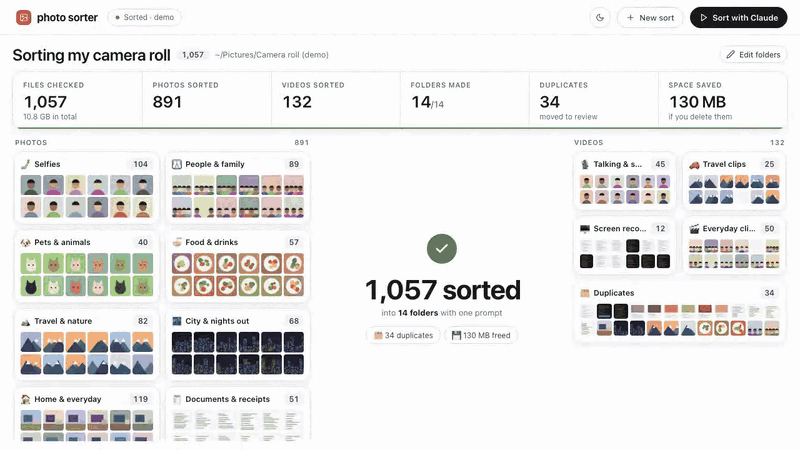

# Claude photo sorter

Point Claude at your camera roll. It looks at every photo and video, sorts them into folders, finds your duplicates, and you watch it happen on a live dashboard on your own laptop.



<sub>The demo above uses drawn placeholder images, not real photos.</sub>

- **Sorts photos and videos** into folders like Selfies, Food, Travel, Screenshots, Talking heads and Screen recordings. Use the standard folders or make your own.
- **Finds duplicates**: identical copies, burst shots and re-saved screenshots go to a `_Review` folder, with a list of which copy was kept.
- **Never touches your originals.** It only reads them and makes sorted copies. On a Mac the copies take no extra space.
- **Uses any AI you have, free ones first.** Gemini, Groq, Mistral, OpenRouter, Ollama (on your computer), Claude Code, or paid OpenAI/Anthropic. In **Auto** mode they share the work and back each other up when one hits its free limit.
- **Runs on your computer.** Your photos are not uploaded anywhere. Only small previews go to the AI you pick.

## Start here (no coding needed)

You need Python 3.9+ and at least one AI: a free key (Gemini or Groq take a minute to get), Ollama, or a Claude plan. Works on Mac, Windows and Linux.

**1. Install Claude Code** from [claude.com/claude-code](https://claude.com/claude-code). Then open the **Terminal** app (press `⌘ Space`, type *Terminal*, press Enter), type `claude` and press Enter.

**2. Paste this to Claude:**

```
Set up and open https://github.com/kairothq/claude-photo-sorter
```

Claude downloads it, sets it up and opens the dashboard in your browser.

**3. In the dashboard:**

1. **Choose folder**: pick the folder with your photos (a Google Photos or Apple Photos export, or any folder).
2. Pick where the sorted copies should go. The default is right next to your photos.
3. Press **Start sorting**.

It shows how long it usually takes, then sorts on its own while you watch every photo fly into its folder. About 4 minutes for 1,000 photos.

<details>
<summary>Don't have your photos on your computer yet?</summary>

- **Google Photos:** go to [takeout.google.com](https://takeout.google.com), select only Google Photos, download, and unzip everything into one folder.
- **iPhone or Apple Photos:** in Photos on your Mac, select all, then File > Export > Export Unmodified Originals, into a new folder.
</details>

## Using it again

The dashboard lives at **http://127.0.0.1:8765** while it's running. To open it again later, either:

- double-click **Open Photo Sorter.command** (Mac) or **Open Photo Sorter.bat** (Windows) in the `claude-photo-sorter` folder, or
- tell Claude "open my photo sorter".

Press **New sort** to sort a different folder, or send the copies somewhere else.

## The dashboard

| | |
|---|---|
| **Sort with Claude** | Before sorting: asks for anything missing, then starts. After sorting: replays the animation (good for screen recording). Add `?d=20` to the address for a slower take. |
| **New sort** | Pick a new photos folder and a new place for the copies. |
| **Advanced** (in the setup card) | See the folders that will be made, remove any, or press **+** to add your own. Choose Claude or Jev. Try 200 photos first. |
| **Click a folder** | Browse everything in it. Click a photo to see it full size, flip with the arrow keys, and **Move to** another folder if it's wrong. |
| **Edit folders** | Rename folders and describe what goes in each. |
| **Open sorted folder** | Opens the result in Finder. |
| ☀ / ☾ | Light or dark. |

Want a look without your own photos? Run `./start.sh --demo`.

## How it works

1. **Scan**: makes a small preview of every file and a fingerprint to spot copies. Your originals are only read.
2. **Duplicates**: compares fingerprints, plus a pixel check for screenshots so similar app screens aren't mistaken for copies.
3. **Labels**: contact sheets of 30 previews go to the AI pool in batches of about 90 files, a few at a time, each picking a folder per file.
4. **Folders**: copies each file into its folder, and duplicates into `_Review/duplicates`. Writes `sorted.csv` and `duplicates.csv`.

### Which AI looks at the photos?

Pick one under **Advanced > Use**, or leave it on **Auto**. Add free keys by pasting them under **Advanced > Add another AI** (saved in `.env` on your computer, never committed), or copy `.env.example` to `.env`.

| AI | Cost | Key |
|---|---|---|
| **Gemini** | free tier, ~10 requests/min | `GEMINI_API_KEY` from aistudio.google.com/apikey |
| **Groq** (Llama 4) | free tier, very fast | `GROQ_API_KEY` from console.groq.com/keys |
| **Mistral** | free "Experiment" plan | `MISTRAL_API_KEY` from console.mistral.ai |
| **OpenRouter** | `:free` models | `OPENROUTER_API_KEY` from openrouter.ai/keys |
| **Ollama** | free, on your computer | none, `ollama pull llama3.2-vision` once |
| **Claude Code** | your Claude plan | none, needs the `claude` command |
| OpenAI / Anthropic | paid | `OPENAI_API_KEY` / `ANTHROPIC_API_KEY`, only used when picked (or `AI_ALLOW_PAID=1`) |
| Custom | yours | `CUSTOM_BASE_URL`, `CUSTOM_MODEL` for LM Studio, vLLM, Together, DeepSeek... |
| Jev (TypeSafe) | billed per file | `JEV_KEY`, shows an estimate and asks first |

**Auto** gives each batch to the least busy ready free AI. If one is rate-limited, out of quota, or answers badly, the batch moves to the next, and bad answers are repaired by asking again for only the missing files. Finished batches are kept, so running again resumes. For the best accuracy set `AI_CONSENSUS=2` (two AIs must agree, a third breaks ties).

From a terminal: `python scripts/label_ai.py --list` shows what is ready; `--ai gemini,groq` sets an order.

## Privacy

- The dashboard only listens on `127.0.0.1`, so nothing else on your network can reach it.
- Previews, labels and the file list stay in `dashboard/data/` and `work/`, which are never committed.
- Contact sheets of 256px previews go to the AI you choose (none with Ollama). Originals never leave your computer. The server refuses requests from other websites and other hostnames, and API keys are never sent back to the page.

## Running it by hand

```bash
python start.py         # Mac, Windows, Linux: sets itself up, opens http://127.0.0.1:8765
./start.sh              # same on Mac/Linux      (Windows: double-click start.bat)
python -m unittest discover -s tests    # self-test with fake AI servers, no keys needed
```

Every step is also a script in `scripts/` (`scan.py`, `dupes.py`, `label_ai.py`, `label_claude.py`, `label_jev.py`, `apply.py`). Agents read `CLAUDE.md` (or `AGENTS.md`) for the full playbook. Needs Python 3.9+, and ffmpeg for video previews (`brew install ffmpeg` / `winget install ffmpeg`).

## License

MIT
